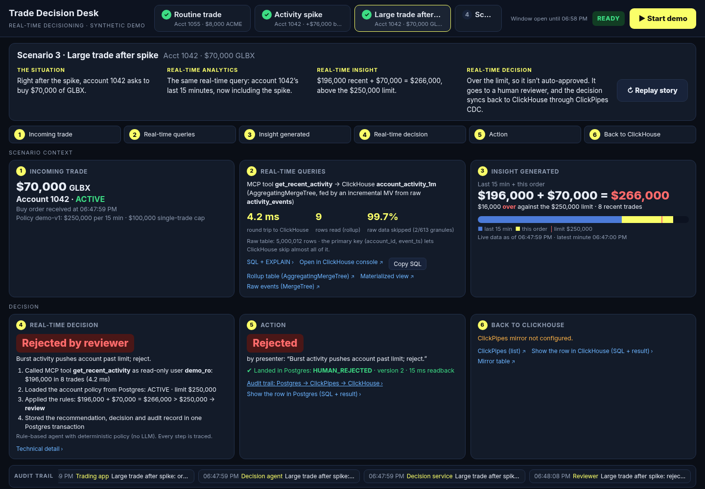

# ClickHouse Trade Decision Demo

A one-page, click-through demo of a **real-time trade decision** built on ClickHouse:

synthetic trading activity → **ClickHouse** (MergeTree + incremental materialized view → AggregatingMergeTree, ~5M rows)
→ a real **MCP tool** over stdio (read-only ClickHouse user) → a deterministic risk policy → a **Postgres** transaction
(requests, recommendations, decisions, append-only audit) → **ClickPipes Postgres CDC** back into ClickHouse
→ optional **Langfuse** trace per trade. All data and accounts are fictitious. Nothing trades.



## Quickstart: one command, local (about 3 minutes)

Needs: **Docker** (Desktop or Engine, running, with Compose v2), **Python 3.11+** (the installer finds
`python3.11`–`python3.14` on your PATH, or fetches one if [uv](https://docs.astral.sh/uv/) is installed), `make`, `curl`.
macOS or Linux (on Windows, use WSL2). No accounts or keys.

```bash
git clone https://github.com/vihag/clickhouse-trade-decision-demo.git
cd clickhouse-trade-decision-demo
./install.sh
```

It ends with `INSTALL OK (local)  Demo running at http://127.0.0.1:8000`. Open that URL → **▶ Start demo** → wait for
**READY** → click through the four scenario tabs (**▶ Run scenario** on each; on scenario 3, click **Reject**).

What `./install.sh` does (each step is idempotent: if it stops with `INSTALL FAILED`, fix what it names and rerun):
1. checks prerequisites, creates `.env` from `.env.example` (mode 600) and a Python venv;
2. starts ClickHouse 25.8 + Postgres 17 in Docker (`docker-compose.yml`), picking free ports if 8123/5433 are taken;
3. `make bootstrap`: schemas, ~5M synthetic rows, the read-only MCP user `demo_ro`, demo reset, preflight → `GREEN`;
4. starts the app in the background, runs the offline test suite and a scripted trial of all scenarios through the
   running app, then leaves it clean and READY.

`make stop` stops the app; `make teardown` also removes the containers and their data. `make help` lists everything.

> Linux with Docker that needs root: `DOCKER="sudo docker" ./install.sh` (and the same for `make teardown`).

## Cloud: ClickHouse Cloud + Managed Postgres + ClickPipes (about 15 minutes)

The full story (CDC back into ClickHouse, console deep links) needs ClickHouse Cloud. You fill **two values**; the
installer creates everything else through the ClickHouse Cloud API.

1. ClickHouse Cloud console → **Organization → API keys → New API key**, organization role **Admin**.
2. Put the key in `.env` (run `./install.sh` once, or `cp .env.example .env`):
   ```
   CLICKHOUSE_CLOUD_API_KEY=...
   CLICKHOUSE_CLOUD_API_SECRET=...
   ```
   Optional: `LANGFUSE_PUBLIC_KEY` / `LANGFUSE_SECRET_KEY` / `LANGFUSE_BASE_URL` for per-trade traces (works on the
   local path too), and `CLICKHOUSE_REGION` (default `us-east-1`).
3. Preview what will be created, without changing anything: `make cloud-check`
4. `./install.sh` (it switches to the cloud path when the key is set; `--local` / `--cloud` force a mode).

It creates (or reuses on rerun):
- a ClickHouse service `trade-decision-demo` (aws, idles after 15 min; IP allow list = this machine's public IP),
- a **Managed Postgres** `trade-demo-pg` (beta, smallest size `r8gd.medium`, Postgres 17),
- after bootstrap, a **ClickPipe** `trade_demo_pg_cdc` (Postgres CDC, 6 tables → database `trade_demo_cdc`).

Generated passwords go into `.env` and `.pg_conn` (both mode 600, git-ignored) and are never printed.
The ClickPipe does its initial load in the background; the UI shows "catching up" until the mirror has the rows (~1-2 min).

Clean up when done: `make teardown` (deletes the ClickPipe and Managed Postgres, keeps the service, which idles to
zero) or `make cloud-destroy` (also deletes the ClickHouse service). Resources bill against your organization
(trial credits cover a demo).

Reusing an existing service instead: set `CH_CONSOLE_SERVICE_ID` and that service's `CLICKHOUSE_PASSWORD` in `.env`.

## Local vs cloud

| Piece | Local (`./install.sh`) | Cloud (API key set) |
|---|---|---|
| ClickHouse `trade_demo` (~5M rows, MV → AggregatingMergeTree, `EXPLAIN indexes=1` pruning) | Docker ClickHouse | ClickHouse Cloud service |
| MCP tool `get_recent_activity` over stdio as read-only `demo_ro` | real | real |
| Postgres system of record (`POSTGRES_MODE`) | Docker Postgres (`local`) | Managed Postgres (`managed`) |
| ClickPipes CDC mirror (step 6, audit trail) | shown as "not configured" | real, ~60 s sync |
| "Open in console" links | local ClickHouse Play UI | ClickHouse Cloud console |
| Langfuse traces + `human_approved` score | if keys are set | if keys are set |
| Activity feed, accounts, policy | simulated (synthetic producer, fictitious, deterministic rules, no LLM) | same |

## Presenting it

See [`docs/RUN_OF_SHOW.md`](docs/RUN_OF_SHOW.md) for the click path and talking points. Highlights:
- **Start demo** resets everything and writes the 15-minute baselines; after ~10 minutes the page shows
  **WINDOW EXPIRED**, so click Start demo again.
- Optional public URL: `make tunnel-bg` (needs `ngrok` + `ngrok config add-authtoken ...`; set `NGROK_DOMAIN` for a
  fixed domain). Anyone with the link can press Start demo.
- Optional: `DECK_PATH=/path/to/slides.html` adds a **Deck** link served read-only at `/deck`.
- Optional app telemetry into ClickHouse Observability: [`docs/OBSERVABILITY.md`](docs/OBSERVABILITY.md).

## Troubleshooting

| Symptom | Fix |
|---|---|
| `Docker is installed but not responding` | start Docker Desktop, rerun `./install.sh` |
| `permission denied ... docker.sock` (Linux) | `DOCKER="sudo docker" ./install.sh` |
| `Python 3.11+ not found` | macOS: `brew install python@3.12`; Ubuntu: `apt install python3.12 python3.12-venv`; or install uv |
| a port is in use | handled: the installer picks free ports and stores them in `.env` (`LOCAL_CH_PORT`, `LOCAL_PG_PORT`, `APP_PORT`) |
| page says **NOT READY** | click the badge for the failing check and its hint, or run `make preflight` |
| **WINDOW EXPIRED** | click Start demo again |
| cloud: bootstrap can't reach ClickHouse | your exit IP differs from the detected one (VPN/proxy): set `CLICKHOUSE_IP_ALLOW` (or add your IP in the console) |
| cloud: `organizations` error | the key sees several orgs: set `CH_CONSOLE_ORG_ID` |
| cloud: Managed Postgres create fails | Managed Postgres is in beta; check it's offered in your org/region, or set `CLICKHOUSE_REGION` |
| Langfuse check fails | keys and `LANGFUSE_BASE_URL` must be from the same project and region (EU `cloud.langfuse.com`, US `us.cloud.langfuse.com`) |

Logs: `logs/app.log`. Evidence of the last scripted trial: `evidence/previous_run/<timestamp>/`.

## Tests

- `make test-offline`: fast; local Postgres + faked ClickHouse/MCP (run by `./install.sh` on the local path).
- `make test`: live end-to-end against whatever `.env` points at.
- CI (`.github/workflows/test.yml`) runs the full `./install.sh --local` on every push.

## Using an AI coding agent

Point it at [`AGENTS.md`](AGENTS.md): setup contract, rules (secrets, idempotency), layout and how to verify.

## License

MIT, see [LICENSE](LICENSE).
